# litmar

`litmar` es una herramienta de Python para reunir literatura científica de varias
fuentes en una sola biblioteca. Busca en servicios con API pública, convierte
cada resultado a un modelo común (`Articulo`), elimina duplicados por DOI y
exporta el conjunto a BibTeX para usarlo en LaTeX o en un gestor de referencias.

Se puede usar desde la línea de comandos o como librería.

## Instalación

Requiere Python 3.12 o superior y [uv](https://docs.astral.sh/uv/).

```bash
uv sync                 # librería y CLI (en desarrollo incluye también la interfaz web)
uv sync --extra ui      # fuera del grupo dev: añade Streamlit para `litmar ui`
uv run litmar --help
```

Con pip: `pip install .` o, con la interfaz web, `pip install '.[ui]'`.

## Configuración

Las claves y datos de cada fuente se leen de variables de entorno. Lo más cómodo
es un fichero `.env` en el directorio desde el que ejecutas `litmar`:

```bash
cp .env.example .env    # y rellena lo que necesites
```

Para buscar todo es opcional: sin configurar nada funcionan OpenAlex, Crossref,
Europe PMC, arXiv y PANGAEA. Para resumir con un modelo de lenguaje hacen falta
`LITMAR_MODELO` y la clave de su proveedor. `.env.example` explica cada variable:

| Variable | Fuente | Para qué |
| --- | --- | --- |
| `OPENALEX_API_KEY` | OpenAlex | Presupuesto diario propio en lugar del compartido |
| `CROSSREF_MAILTO` | Crossref | Entrar en el *polite pool*, con límites más altos |
| `ZOTERO_USER_ID` o `ZOTERO_GROUP_ID` | Zotero | Biblioteca en la que buscar (sin ella, Zotero no aparece) |
| `ZOTERO_API_KEY` | Zotero | Solo para bibliotecas privadas |
| `LITMAR_MODELO` | Modelo de lenguaje | `proveedor:modelo`, p. ej. `google_genai:…` o `anthropic:…` |
| `GOOGLE_API_KEY` o `ANTHROPIC_API_KEY` | Modelo de lenguaje | La clave del proveedor elegido |
| `LITMAR_LLAMADAS_POR_MINUTO` | Modelo de lenguaje | Límite de llamadas (10 por defecto, para el plan gratuito de Gemini; 0 = sin límite) |

`.env` no se sube a git. Las variables que ya estén definidas en el entorno
tienen prioridad sobre las del fichero.

## Interfaz web

```bash
uv run litmar ui
```

Abre en el navegador una página para:
- escribir la búsqueda, elegir las fuentes y el número de resultados por fuente;
- ver una tabla con año, citas, autores, título y enlace al DOI, sin duplicados
  entre fuentes;
- descargar los resultados en BibTeX o en CSV (el CSV se abre bien en Excel).

Si una fuente falla, se muestra el error y se siguen viendo los resultados de las
demás. Las opciones adicionales se pasan a Streamlit, por ejemplo
`uv run litmar ui --server.port 8600`. `litmar ui` desactiva las estadísticas de
uso que Streamlit envía por defecto. La primera vez, Streamlit pide un correo para
su boletín: es opcional y basta con pulsar Intro para saltarlo.

## Línea de comandos

```bash
# Buscar en OpenAlex (la fuente por defecto) y ver una tabla de resultados
uv run litmar buscar "microplastics Mediterranean" --n 5

# Varias fuentes, solo desde 2020, y exportar directamente a BibTeX
uv run litmar buscar "posidonia carbon" --fuente openalex,europepmc \
    --desde 2020 --bibtex refs.bib

# Consultar hasta 30 artículos y guardar todos sus metadatos
uv run litmar buscar "machine learning" -n 30 --guardar biblioteca.json

# Ampliar la misma biblioteca con otra búsqueda
uv run litmar buscar "deep learning" -n 20 --guardar biblioteca.json

# Generar referencias para LaTeX u otras herramientas compatibles
uv run litmar exportar biblioteca.json --bibtex referencias.bib
```

- **Combinar resultados:** si el JSON ya existe, los resultados se combinan con
  los artículos guardados. Los DOI se normalizan y, ante duplicados, se conserva
  el artículo original.
- **Guardado seguro:** el JSON se reemplaza de forma atómica. Un JSON inválido se
  rechaza sin sobrescribirlo.
- **Salida:** una tabla con año, citas, autores y título, ajustada al ancho de
  la terminal:
  ```
  AÑO   CITAS  AUTORES            TÍTULO
  2012    698  Collignon et al.   Neustonic microplastic and zooplankton in the North…
  2015    438  Fossi et al.       Fin whales and microplastics: The Mediterranean Sea…
  ```
- **`--fuente`:** una o varias, separadas por comas: `openalex` (por defecto),
  `crossref`, `europepmc`, `arxiv`, `pangaea` y `zotero`. Los resultados se
  juntan sin duplicar DOI. Si una fuente falla, se avisa y se sigue con las demás;
  si fallan todas, es un error y no se guarda nada.
- **`-n` / `--n`:** máximo de artículos válidos **por fuente**. Puede haber menos
  si no hay suficientes resultados con DOI, título, año y autores.
- **`--desde AÑO`:** solo artículos publicados ese año o después. Se pide como
  filtro a cada API (salvo Zotero, que no lo admite) y además se comprueba el año
  de cada resultado.
- **`--bibtex`:** exporta los resultados de esa búsqueda. Para exportar una
  biblioteca acumulada con `--guardar`, usa `litmar exportar`.
- **Exportar:** la exportación reemplaza el fichero BibTeX de destino si ya
  existe.
- **Códigos de salida:** los errores operativos (red, HTTP, ficheros) devuelven
  1 y los argumentos inválidos, 2.
- **`python -m`:** la CLI también se ejecuta con `uv run python -m litmar`.

La clave de OpenAlex se lee de `OPENALEX_API_KEY`, del `.env` (ver
[Configuración](#configuración)) o del entorno:

```bash
# bash / zsh (macOS, Linux)
export OPENALEX_API_KEY="tu-clave"
uv run litmar buscar "bibliometrics" -n 5
```

```powershell
# PowerShell (Windows)
$env:OPENALEX_API_KEY = "tu-clave"
uv run litmar buscar "bibliometrics" -n 5
```

## Revisión de literatura con un modelo de lenguaje

`litmar revisar` responde a una pregunta de investigación con un informe que
solo cita artículos reales, y el BibTeX de lo citado. Necesita `LITMAR_MODELO` y
la clave de su proveedor en el `.env` (ver [Configuración](#configuración)).

```bash
uv run litmar revisar "¿Cómo afecta el calentamiento a las praderas de Posidonia oceanica?"
```

```
> planificar         3 consultas
> buscar             50 artículos
> filtrar            6 seleccionados
> resumir_articulos  6 resúmenes
> sintetizar         informe (5 citas)
> verificar_citas    ok
Informe guardado en ejemplos/revisiones/2026-11-18_1530_como-afecta-el-calentamiento-a-las-praderas-de/revision.md.
5 artículos citados exportados a ejemplos/revisiones/2026-11-18_1530_como-afecta-el-calentamiento-a-las-praderas-de/revision.bib.
```

Es un flujo fijo de LangGraph (`src/litmar/flujo.py`) con seis pasos. Tres usan
el modelo y tres son código normal:

```mermaid
flowchart LR
    START([START]) --> planificar
    planificar["LLM · planificar<br/>Convierte la pregunta en 2-3 búsquedas"] --> buscar
    buscar["CÓDIGO · buscar<br/>Consulta las fuentes"] --> filtrar
    filtrar["CÓDIGO · filtrar<br/>Con resumen, sin duplicados, los N más citados"] --> resumir_articulos
    resumir_articulos["LLM · resumir_articulos<br/>Un resumen estructurado por artículo"] --> sintetizar
    sintetizar["LLM · sintetizar<br/>Escribe la síntesis citando por DOI"] --> verificar_citas
    verificar_citas["CÓDIGO · verificar_citas<br/>¿Cada DOI citado está entre los seleccionados?"]
    verificar_citas -- "citas inventadas: reescribir (máx. 2)" --> sintetizar
    verificar_citas -- "ok" --> END([END])
```



- **`verificar_citas`** comprueba con código que cada DOI citado está entre los
  artículos resumidos. Si alguno no está, el modelo reescribe la síntesis (como
  mucho 2 veces); si después sigue habiendo DOI inventados, se sustituyen por
  «[cita no verificada]» y se avisa. Ningún DOI sin comprobar llega al informe ni
  al BibTeX.
- **Dónde se guarda:** cada revisión, en su propio subdirectorio de
  `ejemplos/revisiones/`, con la fecha, la hora y la pregunta en el nombre. Una
  revisión nunca pisa a otra (si coincide el nombre, se añade `-2`) y una que
  falla no deja carpeta. `ejemplos/revisiones/` está en el `.gitignore`.
  `--informe` y `--bibtex` permiten elegir otra ruta.
- **El informe** (`revision.md`) incluye la pregunta,
  las búsquedas, la síntesis, las referencias (las escribe el código a partir de
  lo citado, no el modelo) y los avisos (fuentes que fallaron, resúmenes que no
  se pudieron hacer).
- **El BibTeX** (`revision.bib`): solo los artículos citados.
- **`--fuente`** (por defecto `openalex,europepmc`), **`-n`** (artículos que se
  resumen: 6 por defecto, 10 como máximo) y **`--desde AÑO`**.
- **Coste:** una llamada para planificar, una por artículo y de 1 a 3 para la
  síntesis. Con el límite de 10 llamadas por minuto, en torno a minuto y medio.

## Uso desde Python

```python
from litmar import Biblioteca
from litmar.fuentes import OpenAlex, Pangaea

biblioteca = Biblioteca()
with OpenAlex() as openalex, Pangaea() as pangaea:
    for articulo in openalex.buscar("ocean acidification", n=20):
        biblioteca.agregar(articulo)
    for dataset in pangaea.buscar("ocean acidification", n=20):
        biblioteca.agregar(dataset)

biblioteca.guardar("biblioteca.json")
recuperada = Biblioteca.cargar("biblioteca.json")
recuperada.exportar_bibtex("referencias.bib")
```

- **`Articulo`:** registro inmutable con título, autores, año, DOI, revista,
  resumen y número de citas. El DOI se normaliza (sin `https://doi.org/`, en
  minúsculas) y actúa como identidad.
- **`Biblioteca`:** colección ordenada sin duplicados.
  - `agregar` devuelve `False` si el DOI ya estaba.
  - `obtener(doi)` admite el DOI en cualquier formato.
  - `guardar` y `cargar` leen y escriben el JSON.
  - `a_bibtex` y `a_csv` devuelven el texto exportado.
- **Fuentes:** todas heredan de `Fuente` e implementan
  `buscar(consulta, n) -> list[Articulo]`. Reintentan solas ante errores de red,
  `429` y `5xx`, con espera exponencial y respetando `Retry-After`.

El JSON es una lista de artículos con `title`, `authors`, `year`, `doi`,
`journal`, `abstract` y `citations`. Conserva los caracteres Unicode y el orden
de inserción. Al cargar, `abstract` y `citations` son opcionales y toman los
valores `""` y `0`.

### Resumen estructurado con un modelo de lenguaje

`resumir(articulo, pregunta, modelo)` le pide al modelo un `ResumenArticulo`
(objetivo, método, hallazgos, relevancia de 1 a 5 para la pregunta y
limitaciones) con `with_structured_output`. Así la respuesta llega como un
objeto Pydantic ya validado, no como texto. Si el artículo no tiene resumen,
devuelve `None` sin llamar al modelo. Sirve cualquier modelo de chat de
LangChain; `crear_modelo()` crea el que diga `LITMAR_MODELO`, con el límite de
llamadas por minuto, y si falta algo en el `.env` lanza `ErrorDeConfiguracion`
con un mensaje que dice qué añadir.

`ejemplos/resumir.py` busca 3 artículos sobre *ocean acidification* y resume
cada uno (`uv run python ejemplos/resumir.py`). Cambia `TEMA` y `PREGUNTA` por
los tuyos, y `LITMAR_MODELO` en el `.env` para comparar modelos.

```python
from dotenv import load_dotenv

from litmar.llm import crear_modelo
from litmar.resumen import resumir

load_dotenv()  # el comando `litmar` lo hace solo; un script propio, no
modelo = crear_modelo()

resumen = resumir(articulo, "¿Cuánto carbono almacena Posidonia?", modelo)
if resumen:
    print(resumen.relevance, resumen.findings)
```

## Fuentes

Todas las fuentes descartan los resultados a los que les falta DOI o autores,
porque `Articulo` los exige.

### OpenAlex

Catálogo abierto de trabajos académicos. La clave de API es opcional:
- **Sin clave:** se comparte un presupuesto diario por IP.
- **Con una clave gratuita** (<https://openalex.org/settings/api>): el
  presupuesto es propio y mayor.

```python
OpenAlex(api_key="...")
```

### Crossref

Metadatos de artículos de revista registrados en Crossref. No necesita clave.

- Solo devuelve artículos de revista, sin libros, capítulos ni datasets.
- Sin identificarse se usa el pool público: 1 petición por segundo.
- Con `mailto`, la búsqueda entra en el *polite pool*, con límites más altos.
  El correo se envía a Crossref en cada petición.

```python
Crossref(mailto="tu@correo.org")
```

### Europe PMC

Repositorio abierto de literatura biomédica y de ciencias de la vida, mantenido
por EMBL-EBI. No necesita clave.

### arXiv

Preprints de física, matemáticas, informática y otras áreas. No necesita clave.

- **Consulta:** se envía como `all:<texto>`. La sintaxis avanzada de arXiv
  (prefijos como `ti:` o `au:`, y `AND`/`OR`/`ANDNOT`) se pasa sin cambios.
- **Pausa entre páginas:** arXiv pide 3 segundos entre peticiones consecutivas,
  y `buscar` los respeta al paginar.
- **DOI:** si el preprint no tiene DOI de revista, se usa el que asigna arXiv
  (`10.48550/arXiv.<id>`).

### Zotero

Búsqueda dentro de una biblioteca de Zotero, personal o de grupo, con la API web
v3.

```python
Zotero(user_id=123456)  # biblioteca personal pública
Zotero(group_id=7890, api_key="...")  # biblioteca de grupo privada
```

- **Identificador:** hay que indicar exactamente uno de `user_id` o `group_id`.
  Son números:
  - el de usuario está en <https://www.zotero.org/settings/keys>;
  - el de grupo, en la URL del grupo.
- **Clave:** solo hace falta si la biblioteca no es pública. Se envía en una
  cabecera, no en la URL.
- **Citas:** Zotero no guarda recuentos de citas, así que `citations` es
  siempre `0`.

### PANGAEA

[PANGAEA](https://www.pangaea.de/) es un repositorio de **datasets** de ciencias
de la Tierra y del medio ambiente. No necesita clave.

- La consulta se busca en su índice público de Elasticsearch y deben aparecer
  todos los términos. Se acepta cualquier texto, incluidas comillas, barras o
  paréntesis.
- Como un dataset no tiene revista, el campo `journal` es siempre `"PANGAEA"`.
- `citations` es siempre `0`: PANGAEA no publica ese dato.
- Los autores llegan como `"Apellido, Nombre"`. Las instituciones conservan su
  nombre completo.
- También se descartan los datasets a los que les falta título o año.
- Elasticsearch no deja pasar del resultado 10 000, así que `buscar` nunca
  devuelve resultados más allá de esa posición.

Al exportar a BibTeX, los datasets aparecen como entradas `@article`, igual que
los artículos.

## Tests

```bash
uv run pytest
uv run ruff check        # errores típicos e imports (con --fix los corrige)
uv run ruff format       # formato común para todo el código
```

Los tests no usan la red ni necesitan claves:
- las fuentes se prueban con `httpx.MockTransport` y respuestas reales guardadas
  en `tests/datos/`;
- también cubren los modelos, la deduplicación, los reintentos, la persistencia
  y el flujo de la CLI hasta la exportación BibTeX;
- la interfaz web se prueba con `streamlit.testing` y fuentes simuladas.
